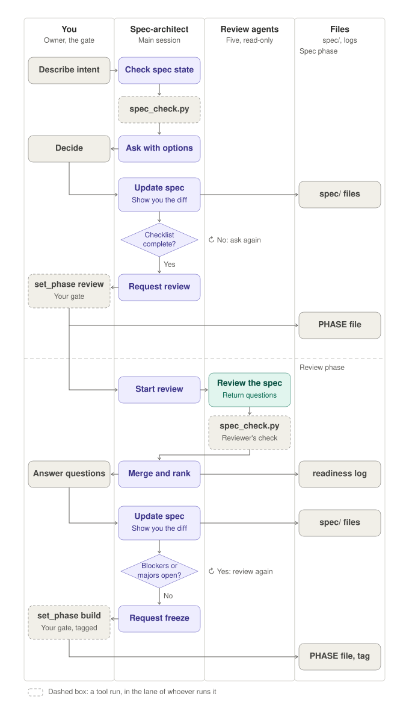

# Development Plan: Agentic Spec-Driven FPGA Development

**Status:** covers milestones M0 and M1. Later milestones are listed in the
overview but are planned in detail only when the previous milestone is
complete (see section 2).

**Audience:** the owner, and every agent working in this repository. Agents
must follow this plan; where an agent definition and this plan disagree, stop
and ask the owner.

---

## 1. Purpose

This project tests a claim:

> A design can be specified as an executable Gherkin specification and then
> designed, verified, built and proven on hardware by independent AI agents,
> with the owner making every decision and writing no design or test code.

The end goal is a live demonstration: change one rule in a feature file, and
about ten minutes later the change is running on a development board and
proven by tests on live Ethernet traffic.

The experiment is only credible if its rules and success criteria are fixed
before the results are known. This plan records both.

## 2. How this plan evolves

The plan grows with the project, the same way the design does: a *walking
skeleton*. Each milestone adds only the process it needs.

- Only the current and next milestone are planned in detail.
- Every milestone ends with a short retrospective: what worked, where the
  process creaked, what to change.
- The retrospective's conclusions are written into this plan before the next
  milestone starts.

## 3. Operating principles

These apply from M0 onward. They are project policy; changing one is a flow
change (section 7.4) and needs the owner's approval and a decision-log entry.

1. **The owner is the gate.** The owner makes every design decision, and
   personally performs every gate: entering review, freezing the spec, and
   merging to `main`. Agents may request a gate; they never pass one.
2. **Every answer goes into the spec.** Anything agreed in conversation that
   matters to design or verification is recorded in `spec/`. Nothing exists
   only in a conversation.
3. **The spec has a single writer.** Only the spec-architect edits `spec/`,
   and only with the owner's agreement.
4. **Design and verification are independent.** The rtl-designer never sees
   tests; the verification-engineer never sees RTL. Failure reports between
   them describe behaviour only (scenario, stimulus, expected, observed).
5. **Scripts decide pass or fail.** No agent declares that something passed.
   Gates are run by tools, locally and in CI.
6. **Infrastructure belongs to the owner.** No agent may modify `tools/`,
   `.claude/`, CI workflows or policy files.
7. **Every intervention is recorded.** Each time the owner steps in, it is
   logged by category (section 13). The log is part of the result.

## 4. Roles

| Role | Kind | Active from | Writes | Cannot access |
|---|---|---|---|---|
| Owner | Human | M0 | Decisions, gates, infrastructure | - |
| spec-architect | Main session | M1 | `spec/`, `pkg/`, `reports/` | Writes to `rtl/`, `tb/` |
| build-orchestrator | Main session | M1 | Nothing (delegates) | - |
| rtl-designer | Subagent | M1 | `rtl/` (build phase only) | `tb/` |
| verification-engineer | Subagent | M1 | `tb/` (build phase only) | `rtl/` |
| reviewer | Subagent | M1 | Nothing (read-only) | - |
| physical-engineer | Subagent | M2 | Constraints, Vivado build, release package | `tb/`, `hwtest/` |
| integration-engineer | Subagent | M2 | `hwtest/`, programs the board | `rtl/`, `tb/` |

**Spec-architect.** Interviews the owner and turns the answers into the
specification: feature files, block diagram, interface contracts, project
layout, decision log. Presents options with trade-offs; never decides.

**Build-orchestrator.** Coordinates the build phase: delegates to the build
agents, runs the gates, routes findings. Writes no code and no spec.

**Rtl-designer.** Implements synthesizable VHDL-2008 from the frozen spec,
following the style guide and the project layout.

**Verification-engineer.** Writes black-box, self-checking testbenches from
the feature files, one result line per scenario example row.

**Reviewer.** Read-only. Reviews the spec for consistency in the review
phase; in the build phase, reviews RTL, tests and traceability, and triages
every failure as an RTL bug, a test bug or a spec gap.

**Physical-engineer and integration-engineer** join in M2. Their roles, the
release package and its hand-off checklist will be planned in detail in the
M2 section.

Agents never talk to each other directly. Every interaction is a
conversation with the owner, a delegation from a main session, a file one
agent writes and another reads, or a tool run.

## 5. Phases and gates

Work on each change moves through three phases, recorded in `spec/PHASE`.

| Phase | Main session | What happens | Code allowed |
|---|---|---|---|
| `spec` | `claude --agent spec-architect` | Interview, artifacts, definition of ready | No |
| `review` | `claude --agent spec-architect` | Readiness review; questions resolved into the spec | No |
| `build` | `claude --agent build-orchestrator` | Design, verification, gates, review | Yes |

### 5.1 Spec and review process map



Dashed boxes are tool runs, drawn in the lane of whoever runs the tool.

- **Both gates are in the owner's lane.** The owner runs `set_phase review`
  and `set_phase build` personally. Each writes the phase file; the freeze
  also creates a tag.
- **The architect starts the review after the gate.** The arrow from the
  owner's `set_phase review` to "Start review" is the owner telling the
  architect, in the conversation, that the gate is open. The architect may
  confirm by reading the phase file, but does not proceed on its own.
- **The architect only requests the gates.** "Request review" and "Request
  freeze" are in its lane; the decision is the owner's.
- **The reviewer runs its own `spec_check.py`** in the readiness review, as an
  independent check of the architect's claim that the spec is complete.

### 5.2 Making the gates real

Agents run commands as the owner's Linux user, so a name on a commit does not
by itself prove the owner made the decision. M0 adds these protections:

1. Agents cannot run `set_phase` (blocked by hooks).
2. Agents cannot write `spec/PHASE` or `spec/phase_history.md` directly.
3. `set_phase` refuses to run unless attached to an interactive terminal, and
   asks the owner to type the phase name to confirm.
4. Optionally, `set_phase build` creates a signed tag (open decision O-2).

## 6. Build phase in M1 (simulation only)

M1 has no hardware stages. The build phase is:

1. The orchestrator delegates to the rtl-designer and the
   verification-engineer **in parallel**, both working from the frozen spec.
2. The orchestrator runs the gates: layout, compile, VSG `jcl` style, Yosys
   resource estimate (no latches), and simulation tests.
3. The orchestrator asks the reviewer for a build review and triage.
4. Findings are routed:
   - RTL bug, or architecture/layout/style must-fix: to the rtl-designer;
   - test bug: to the verification-engineer;
   - spec gap: **stop**. The owner takes it to the spec-architect in a new
     session, and the phase returns to review.
5. Steps 2 to 4 repeat, at most five iterations; then the orchestrator stops
   and reports what is blocking.

**Failure reports are structured files**, not prose (an M0 task): fixed fields
for scenario, stimulus, expected and observed, passed between agents unchanged.
This limits what the orchestrator can leak between the independent agents.

The build-phase process map will be drawn in the same style as section 5.1
once M1 has been run.

## 7. Configuration management

### 7.1 Repositories

- **Forgejo, on the owner's machine, is the working server.** Agents push
  change branches to it, CI runs there, and merges happen there.
- **GitHub is the archive and the place progress is published.** The owner
  decides when to publish, through a push mirror from Forgejo. Agents never
  communicate with GitHub.

### 7.2 Branches and merging

- **`main` is always green**: it only contains work that passed every stage
  required for its change class (7.4) at that milestone.
- **One short-lived branch per change**, e.g. `cr/001-m1-ptp-rebuild`. The
  whole life of a change (spec, freeze, build, review) happens on its branch.
- **Merging is the owner's acceptance gate.** Only the owner merges.
- **Fast-forward merges only.** `main` moves to exactly the commit that was
  tested. If `main` has moved, the branch is rebased and re-verified.
- **No squashing.** Every iteration (failed attempts, findings, fixes) stays
  in the history; it is experiment data.

### 7.3 Tags and commits

| Tag | Created by | Meaning |
|---|---|---|
| `spec-frozen-N` | Owner, via `set_phase build` | The exact spec a build was made from |
| `mN-complete` | Owner | The merged state that met milestone N's exit criteria |

- **Each agent commits under its own name** (e.g. author `rtl-designer`), with
  trailers recording the role and the frozen spec it worked from:
  `Agent: rtl-designer`, `Spec-Tag: spec-frozen-1`.
- **The owner's commits carry the owner's name.** `git log` alone then shows
  which work was human and which was agent.

### 7.4 Change classes and merge requirements

Each change is classified by the files it touches; when several areas are
touched, the strictest class applies. **This table is the initial proposal.
The final policy is decided by the owner with the spec-architect in M0 and
recorded in the decision log; agents cannot change it.**

| Class | Typical paths | Required before merging |
|---|---|---|
| Design | `spec/`, `rtl/`, `pkg/`, constraints | All stages for the milestone |
| Verification | `tb/`, `hwtest/` | The changed tests run (simulation or hardware); no rebuild |
| Flow and infrastructure | `tools/`, `.claude/`, workflows, policy | CI, owner review, and a flow regression run on the last accepted design |
| Documentation | `docs/`, README, presentation material | Owner approval; links and diagrams render |

A flow change does not touch the design, but it changes how the design is
judged; hence the regression run.

### 7.5 Design ID

From M2, each bitstream carries a **design ID**: a hash of the design inputs
only (`rtl/`, `pkg/`, constraints, design-relevant spec files), not of the
whole commit. Documentation or flow changes leave it unchanged, so earlier
hardware results stay valid; any design change produces a new ID. The release
manifest records both the design ID and the commit it was built from.

### 7.6 Exceptions

A change may be merged without a required stage only by a stated, logged
exception. Every exception records:

1. what was skipped;
2. why;
3. what risk that leaves;
4. how and when it will be closed.

The pull request template contains these fields; CI refuses a pull request
that lacks a required result unless they are filled in. Every exception is
copied to `docs/exceptions.md`.

## 8. Continuous integration

CI exists from M0, before any design work, so every milestone is built under it.

- **Server:** Forgejo, running in WSL as a service (systemd enabled in WSL).
- **Workflows:** in `.forgejo/workflows/`. They only call the project's own
  gate scripts, so all gate logic lives in one place.
- **Runner:** the Forgejo runner, registered with a `host` label so jobs run
  directly on the machine with the locally installed tools (Vivado from M2).
  It runs as its own Linux user, so agents cannot alter its workspace or
  results.
- **Checkout:** common actions such as `actions/checkout` need Node.js; with a
  host runner, either install Node.js for the runner user or check out with
  plain `git` in the workflow.
- **Branch protection on `main`:** required CI checks, linear history, no
  force pushes, merging restricted to the owner.
- **Publishing:** a push mirror to GitHub, triggered by the owner.
- **Backups:** the Forgejo data directory (pull requests, reviews, CI history)
  is backed up periodically; the GitHub mirror only preserves git history.

## 9. Tools and environment

Versions are recorded in M0 and pinned; every result names the versions that
produced it.

| Tool | Purpose | Used by | Runs in | From | Version |
|---|---|---|---|---|---|
| Claude Code | Runs the agents | All agents | WSL | M0 | record in M0 |
| Python 3.11+ | Spec check, layout check, hooks | Gates, hooks | WSL | M0 | record in M0 |
| GHDL | VHDL-2008 compile and simulation | Gates | WSL | M0 | record in M0 |
| VSG 3.35 | Style check, `jcl` style | Gates | WSL | M0 | record in M0 |
| Yosys + GHDL plugin | Resource estimate, latch check | Gates | WSL | M0 | record in M0 |
| Git, GitHub CLI | Version control; owner's publishing | Owner | WSL | M0 | record in M0 |
| Forgejo, Forgejo runner | Local git server and CI | CI | WSL | M0 | record in M0 |
| Mermaid (+ CLI) | Diagrams in Markdown; export for slides | Architect, docs | WSL | M0 | record in M0 |
| Vivado (free edition) | Synthesis, implementation, bitstream | Physical-engineer | WSL | M2 | - |
| Vivado hardware server | Programming over JTAG | Integration-engineer | Windows | M2 | - |
| ELFWS | Warning suppression with justifications; gate on new warnings | Physical-engineer | WSL | M2 | - |
| stacv | External interface constraints and validation | Physical-engineer | WSL | M2 | - |
| Python + Npcap | Lab watcher, raw Ethernet tests | Lab | Windows | M2/M3 | - |
| GitHub Releases | Milestone release packages | Owner | GitHub | M2 | - |

To record versions in M0:

```bash
claude --version; python3 --version; ghdl --version | head -1
vsg --version; yosys -V; git --version; gh --version | head -1
```

**Artifact storage.** Releases (from M2) are kept in a local `releases/`
directory and published per milestone as GitHub Releases. The release
manifest (design ID, versions, file hashes) is designed so that moving to an
artifact repository such as Artifactory later would change only where
releases are stored, not the process.

## 10. Directories and ownership

Directories are named after what they contain, not after agents. Ownership
is declared in one place, an ownership map (introduced in M0), which the hooks
and CI read:

- which agent may write each area, and in which phase;
- which agents may not read it;
- which flow stages each agent may run;
- the change class of each area (7.4).

Agents never call vendor tools directly; they run named stages of the shared
gate scripts, and a per-agent hook permits only that agent's stages plus
read-only commands. A separate local Linux user for the agents (true
isolation rather than guardrails) is a later hardening option.

## 11. Diagrams

- **Mermaid by default:** block diagrams, flowcharts, state machines,
  sequences. Text, versioned, diffable, rendered by GitHub and Forgejo, and
  editable by agents.
- **SVG where the layout itself carries meaning,** such as process maps, kept
  in `docs/img/` next to the document that uses it.

## 12. Milestones

| Milestone | Slice | New risk it retires |
|---|---|---|
| **M0** | Environment, tools, process tooling, local CI | Tooling and process infrastructure |
| **M1** | PTP filter rebuilt from its spec, simulation only | Spec-to-RTL with independent agents |
| M2 | Board reports its build ID over UART | The whole chain on hardware |
| M3 | Ethernet pass-through, port A to port B | PHY interfaces, clocking, I/O timing |
| M4 | One filter rule, then the red-to-green demonstration | The spec-change loop on hardware |
| M5 | Timed rehearsals of the ten-minute loop | Speed and repeatability |

M2 onward will also need the development board (trade study in progress), the
Windows lab and the test bench; they are planned when M1 is complete.

### 12.1 M0: Environment and process tooling

**Goal:** everything M1 needs exists and is verified, including CI.

**Tasks**

1. **Tools.** Install the M0 tools (section 9) and record their versions.
2. **Gate protections** (section 5.2):
   - `set_phase.sh`: interactive-terminal check and typed confirmation;
   - hooks: protect `spec/PHASE`, `spec/phase_history.md`, `tools/`,
     `.claude/`, workflows and policy files from every agent; block
     `set_phase`, `git push` to GitHub and the GitHub CLI for every agent;
   - spec-architect instructions: ask the owner to run `set_phase`, never run it.
3. **Structured failure reports:** a fixed-field file format for findings
   passed between agents, and the agent instructions to use it.
4. **Ownership map and merge policy file**, machine-readable, read by hooks
   and CI.
5. **Policy interview.** The owner and the spec-architect settle the merge
   policy and change classes (7.4), the exception rules (7.6) and the open
   decisions needed for M1 (section 15), recorded as decisions.
6. **Local CI** (section 8):
   1. enable systemd in WSL, keep WSL running while working;
   2. install Forgejo, reachable from Windows on `localhost`;
   3. create the owner's account, the agents' push account if chosen (O-6),
      and the repository, imported from GitHub;
   4. branch protection on `main`;
   5. install the runner as its own Linux user, `host` label;
   6. first workflow: run the existing gates on every push to a change branch;
   7. configure the GitHub push mirror;
   8. repoint the local clone's `origin` to Forgejo.
7. **Verify early** what M2 will need: the runner user can reach the Windows
   exchange folder (`/mnt/c/...`) and the network.
8. **Backups** of the Forgejo data directory.

**Bootstrapping:** M0 changes infrastructure before CI exists, so M0 work is
committed by the owner directly. Branch protection and the change-branch
workflow apply from the end of M0.

**Exit criteria**

- All M0 tools installed; versions recorded in this plan.
- An agent attempting to write `spec/PHASE`, edit `tools/` or `.claude/`, run
  `set_phase`, or push to GitHub is blocked (each attempted once, logged).
- `set_phase` refuses to run non-interactively.
- Pushing a change branch triggers CI; results appear on the pull request.
- A deliberately failing gate blocks the merge.
- Only the owner can merge to `main`; fast-forward only.
- The runner runs as its own user; agents cannot modify its workspace.
- The owner can publish to GitHub on demand, and GitHub matches local `main`.
- The policy decisions are in the decision log.
- M0 retrospective written; this plan updated.

### 12.2 M1: PTP filter rebuilt from its spec, simulation only

**Goal:** show that independent agents can produce a working design from the
specification alone, measured against a known-good reference.

**Inputs**

- The PTP Delay_Req filter spec already in `spec/`.
- A **golden reference**: the verified RTL and testbench from the original
  design conversation, kept **outside the repository**, where no agent is
  pointed to it. It is used only in step 7.

**Steps**

1. Create the change branch `cr/001-m1-ptp-rebuild`.
2. **Spec phase** with the spec-architect: resolve the six REVIEW markers in
   the feature file and the unconfirmed decision D-012; write the subsystem
   feature files (or record waivers); complete the checklist.
3. **Review phase:** readiness review until no blockers or majors remain.
4. **Freeze:** the owner runs `set_phase build` (`spec-frozen-1`).
5. **Build phase** with the build-orchestrator (section 6), pushing to Forgejo
   so CI runs on every change.
6. **Pull request** on Forgejo with CI green and the reviewer's verdict.
7. **Golden comparison**, run by the owner:
   1. the golden testbench against the agents' RTL;
   2. the agents' testbench against the golden RTL;
   3. resource estimates compared (golden: about 365 LUTs, 959 flip-flops,
      Yosys estimate), for information.

   Any disagreement is triaged as an RTL bug, a test bug or a spec gap. Spec
   gaps are the most valuable finding: they show where the spec was not enough.
8. **Merge** by the owner (fast-forward), tag `m1-complete`, publish to GitHub.
9. **Retrospective**, and plan M2 in this document.

**Exit criteria (fixed before the run)**

- All gates pass, locally and in CI; VSG `jcl` reports zero violations.
- The reviewer's verdict is READY.
- The golden testbench passes against the agents' RTL with no failures.
- The agents' testbench passes against the golden RTL, or each failure is
  triaged and resolved.
- **No rule breaks:** the owner wrote no design or test code. (If one becomes
  unavoidable, it is logged as a rule break, not hidden.)
- Interventions logged; metrics recorded (section 13).
- Retrospective written; M2 planned in this document.

## 13. Evidence and metrics

Recorded for every milestone, in `docs/evidence/mN/`:

- **Intervention log:** one row per owner intervention.

  | # | When | Phase | Category | Trigger | What the owner did | Time |
  |---|---|---|---|---|---|---|

  Categories: **decision** (expected: the owner deciding), **clarification**
  (answering an agent's question), **correction** (fixing an agent's
  mistake), **rule break** (stepping outside the rules), **infrastructure**
  (fixing tools or setup).
- **Time:** elapsed time per phase, and owner time spent.
- **Iterations:** build-phase loops, and what each fixed.
- **Gate results:** the CI history for the change.
- **Resources:** LUT and flip-flop estimates.
- **Tool versions** for every result.

## 14. Risks (M0 and M1)

| Risk | Effect | Mitigation |
|---|---|---|
| Agents ignore or work around instructions | Independence or gates compromised | Hooks, CI as independent judge, reviewer, intervention log |
| Hooks are guardrails, not walls | A determined agent could reach forbidden files | Logged as known limit; separate Linux user for agents as later hardening |
| Same model, same blind spots | Design and tests share a misreading | Different models for designer and verifier; golden comparison in M1 |
| Spec ambiguity | Agents guess | Readiness review; `ASSUMPTIONS.md`; spec gaps stop the build |
| Golden reference visible to agents | Comparison no longer independent | Kept outside the repository, never referenced in prompts |
| WSL services stop when WSL idles | CI unavailable | Keep WSL running; check service status at session start |
| Forgejo data loss | Pull-request and CI history lost | Periodic backups of the data directory |
| Orchestrator leaks details between agents | Independence weakened | Structured failure reports passed unchanged |

## 15. Open decisions

| # | Decision | Needed by |
|---|---|---|
| O-1 | Does the owner approve each spec diff explicitly (an "Approve diff" step), or is answering the question enough? | M1 |
| O-2 | Must the freeze tag be signed? | M1 |
| O-3 | Add an early architecture review (readiness review on the block diagram alone)? | M1 |
| O-4 | Keep each agent's raw question table as an appendix to the readiness log? | M1 |
| O-5 | Must the reviewer's verdict be recorded on the pull request before merging? | M1 |
| O-6 | A single local Forgejo account for agent pushes, or agents push as the owner? | M0 |
| O-7 | Final change classes and merge policy (7.4) | M0 |
| O-8 | Who approves warning waivers, and how (ELFWS is the mechanism) | M2 |
| O-9 | Development board selection (trade study) | M2 |
